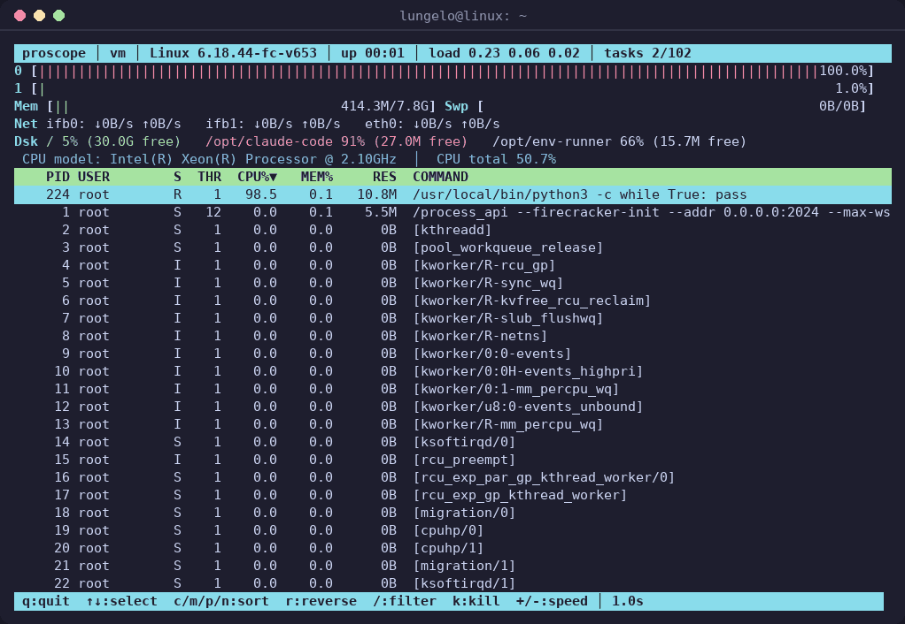

# linux-proscope

**A lightweight terminal system monitor for Linux, written in pure Python with zero dependencies.**

proscope reads its data straight from the kernel's `/proc` pseudo-filesystem and draws it with `curses`. There's no `psutil` and no third-party packages: if a machine has Python 3.8+, proscope runs on it.




## Features

- **Per-core CPU bars** that change colour (green/yellow/red) with load, and switch to two columns on many-core machines
- **Memory and swap** usage, measured from `MemAvailable` the same way `free` does
- **Network throughput** per interface (↓ RX / ↑ TX per second)
- **Disk usage** for real mounted filesystems (ext4, xfs, btrfs, nfs and others)
- **Interactive process table** you can scroll, sort, filter and kill from
- **Load average, uptime, task count** and kernel version in the header
- **Scriptable output** with `--once` (plain text) and `--json`, for cron jobs, logging or piping into `jq`
- Handles terminal resizing, processes that exit mid-read, and the odd process names that break simple parsers

## Install

```bash
git clone https://github.com/lungelongwane/linux-proscope.git
cd linux-proscope
bash install.sh    # installs to ~/.local/bin (run with sudo for /usr/local/bin)
proscope
```

You can also run it without installing:

```bash
python3 -m proscope
```

Or install it with pip:

```bash
pip install .
```

Uninstall with `bash install.sh --uninstall`.

## Usage

```text
proscope [-d DELAY] [-s {cpu,mem,pid,name}] [--once] [--json] [-n LIMIT]

  -d, --delay   refresh interval in seconds (default 1.0)
  -s, --sort    initial sort column (default cpu)
  --once        print one text snapshot and exit
  --json        print one JSON snapshot and exit
  -n, --limit   number of processes in --once/--json output (default 15)
```

### Keybindings

| Key | Action |
|-----|--------|
| `↑` `↓` / `j` | Move selection |
| `PgUp` `PgDn` `Home` `End` | Scroll faster |
| `c` `m` `p` `n` | Sort by CPU / memory / PID / name (press again to reverse) |
| `r` | Reverse sort order |
| `/` | Filter by command, user or PID |
| `k` | Send `SIGTERM` to the selected process (asks first) |
| `+` / `-` | Slow down / speed up refresh |
| `q` / `Esc` | Quit |

### Scripting examples

```bash
# Top 5 memory hogs
proscope --once -s mem -n 5

# Log current memory use every minute (crontab)
* * * * * proscope --json -n 0 | jq -c '{t: now, used: (.mem.total - .mem.available)}' >> ~/mem.log
```

## How it works

| Panel | Kernel source | Notes |
|-------|---------------|-------|
| CPU % | `/proc/stat` | Takes jiffy counters at two points in time and reports `busy / total` between them. `iowait` counts as idle. |
| Memory | `/proc/meminfo` | `used = MemTotal − MemAvailable`. Falls back to `MemFree + Buffers + Cached` on kernels older than 3.14. |
| Load, tasks | `/proc/loadavg` | |
| Uptime | `/proc/uptime` | |
| Network | `/proc/net/dev` | Byte counter differences divided by elapsed time. Loopback is hidden. |
| Disks | `/proc/mounts` + `statvfs(2)` | Pseudo filesystems (tmpfs, proc, cgroup and so on) are left out. |
| Processes | `/proc/<pid>/stat`, `cmdline` | Per-process `utime + stime` differences give CPU %, like `top`. RSS comes from pages × page size. |

A detail worth knowing: a process name (`comm`) can contain spaces and even `)`, so `/proc/<pid>/stat` can't be split on whitespace naively. proscope splits on the **last** `)` in the line, and there's a unit test for that case.

## Project layout

```text
linux-proscope/
├── proscope/
│   ├── procfs.py     # stateless /proc parsers (testable with a fake root)
│   ├── monitor.py    # turns counters into rates and percentages
│   ├── ui.py         # curses interface
│   ├── fmt.py        # byte and uptime formatting
│   └── __main__.py   # CLI entry point
├── tests/            # pytest suite run against a fake /proc tree
├── install.sh
└── .github/workflows/ci.yml
```

## Development

```bash
pip install pytest
python -m pytest -v
```

Every parser takes a `root` argument, so the tests build a small fake `/proc` in a temp directory and get the same results on any machine. CI runs the tests on Python 3.8 through 3.13.

## Roadmap

- [ ] Process tree view (using `ppid`)
- [ ] Disk I/O rates from `/proc/diskstats`
- [ ] CPU temperature from `/sys/class/thermal`
- [ ] Sparkline history graphs
- [ ] Config file for colours and default columns

## License

MIT © Lungelo Ngwane
